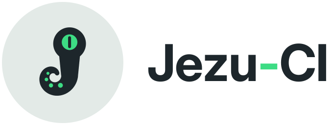

  <picture>
    <source media="(prefers-color-scheme: dark)" srcset="assets/jezu-ci-horizontal-dark.svg">
    
  </picture>

### Bonjour 👋

Consultant en cybersécurité IT : réponse à incident et investigation
numérique (DFIR), expertise des environnements Microsoft (Active Directory,
Entra ID), modèle d'administration en tiers et microsegmentation réseau.

#### 🛰️ Projet principal : [Auspex](https://github.com/Jezu-CI/AUSPEX)

CMDB passive IT/OT, open source (Apache 2.0) : inventaire des actifs et
contrôle de la segmentation réseau **par écoute passive**, sans agent ni
compte de service, avec des exports de preuves pour NIS2, DORA et l'IEC 62443.
Construit sur NetBox et Zeek.

- 🌐 Site et documentation : [jezu-ci.github.io/AUSPEX](https://jezu-ci.github.io/AUSPEX/)
- 📦 Dernière version : [v0.1.0 « Silence Before Dawn »](https://github.com/Jezu-CI/AUSPEX/releases/latest)
- 🧪 Chaque modification est vérifiée sur le vrai produit et sur des captures industrielles réelles

#### 🤖 Transparence

Je ne suis pas développeur de métier : mes projets sont « vibe codés »,
c'est-à-dire écrits avec l'assistance d'une IA. J'apporte le besoin,
l'expertise sécurité et les choix de conception ; la qualité du code est
garantie par des tests automatisés exécutés à chaque modification.

#### Centres d'intérêt

`DFIR` · `Active Directory` · `Entra ID` · `modèle en tiers` · `microsegmentation` · `NetBox` · `NIS2`

#### Contact

Les contributions sont bienvenues, en particulier les
[règles d'identification d'équipements](https://github.com/Jezu-CI/AUSPEX/blob/main/CONTRIBUTING.md).
