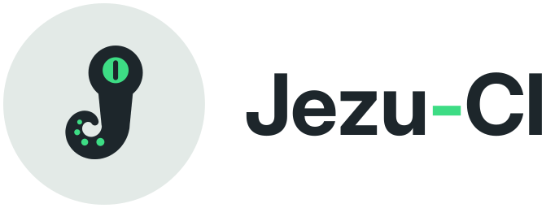

  <picture>
    <source media="(prefers-color-scheme: dark)" srcset="assets/jezu-ci-horizontal-dark.svg">
    
  </picture>

### Bonjour 👋

Consultant en cybersécurité IT : réponse à incident et investigation
numérique (DFIR), expertise des environnements Microsoft (Active Directory,
Entra ID), modèle d'administration en tiers et microsegmentation réseau.

#### 🛰️ Projet principal : [Auspex](https://github.com/Jezu-CI/AUSPEX)

CMDB passive IT/OT, open source (AGPL v3) : inventaire des actifs et
contrôle de la segmentation réseau **par écoute passive**, sans agent ni
compte de service, avec des exports de preuves pour NIS2, DORA et l'IEC 62443.
Construit sur NetBox et Zeek.

- 🌐 Site et documentation : [jezu-ci.github.io/AUSPEX](https://jezu-ci.github.io/AUSPEX/)
- 📦 Dernière version : [v0.2.0 « Lantern in the Void »](https://github.com/Jezu-CI/AUSPEX/releases/latest), signée (Sigstore)
- 🧪 Chaque modification est vérifiée sur le vrai produit et sur des captures industrielles réelles

#### 🤖 Transparence

Je ne suis pas développeur de métier : mes projets sont « vibe codés »,
c'est-à-dire écrits avec l'assistance d'une IA. J'apporte le besoin,
l'expertise sécurité et les choix de conception ; la qualité du code est
garantie par des tests automatisés exécutés à chaque modification.

------------------------------------------- FOR MY NO FRENCH GUYS ----------------------------------------------------------------------------------------------------
Hi there 👋

IT cybersecurity consultant: incident response and digital forensics (DFIR), expertise in Microsoft environments (Active Directory, Entra ID), tiered administration model and network microsegmentation.

🛰️ Main project: Auspex

Passive IT/OT CMDB, open source (AGPL v3): asset inventory and network segmentation verification through passive listening, with no agents or service accounts, plus evidence exports for NIS2, DORA and IEC 62443. Built on NetBox and Zeek.

🌐 Website and documentation: jezu-ci.github.io/AUSPEX
📦 Latest release: v0.2.0 "Lantern in the Void", signed (Sigstore)
🧪 Every change is tested against the real product and real industrial captures
🤖 Transparency

I'm not a developer by trade: my projects are "vibe coded", meaning they are written with the help of AI. I bring the requirements, the security expertise and the design decisions; code quality is ensured by automated tests that run on every change.
#### Centres d'intérêt

`DFIR` · `Active Directory` · `Entra ID` · `modèle en tiers` · `microsegmentation` · `NetBox` · `NIS2`

#### Contact

Les contributions sont bienvenues, en particulier les
[règles d'identification d'équipements](https://github.com/Jezu-CI/AUSPEX/blob/main/CONTRIBUTING.md).
